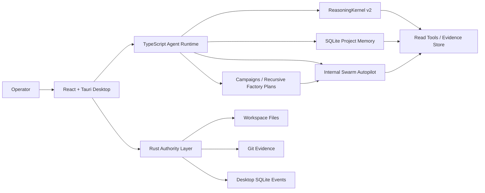
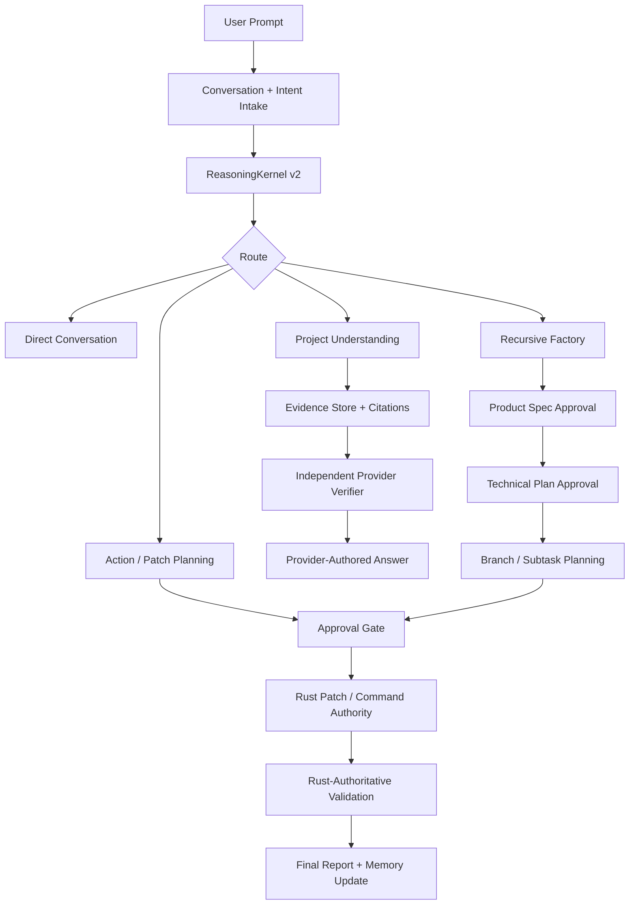
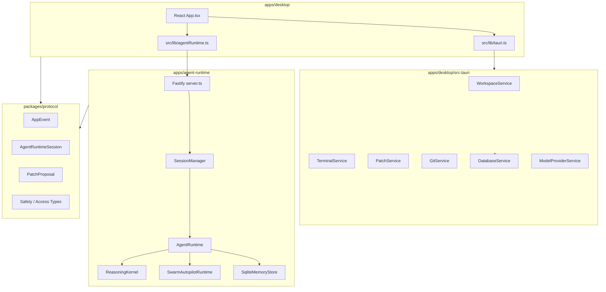
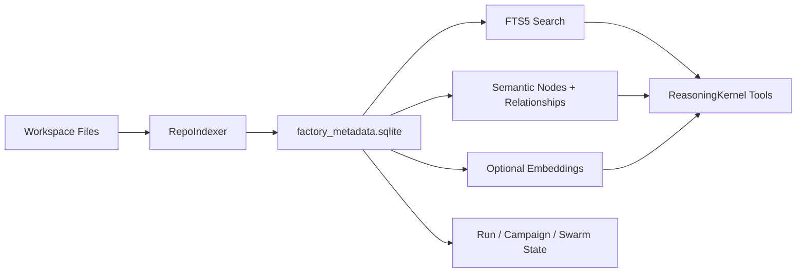
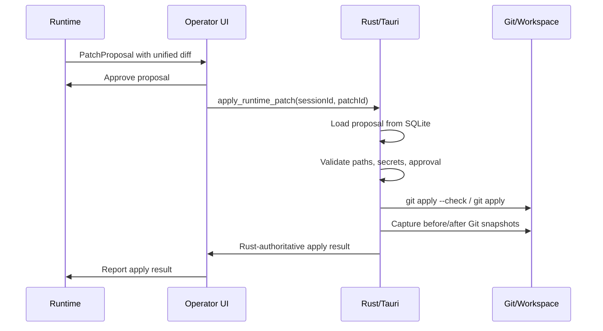
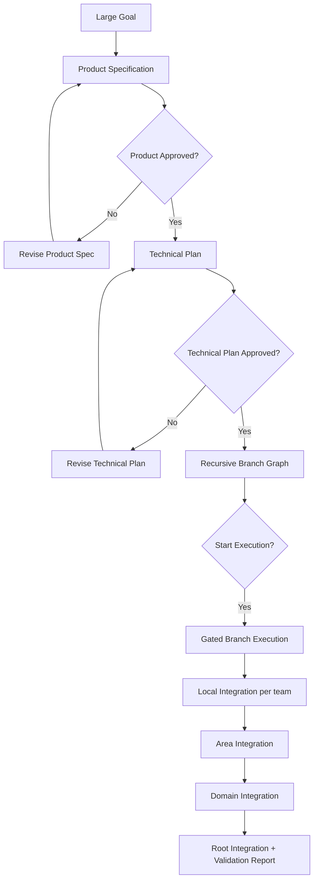

# Hivo Studio - Multi-Agent Coding System

Hivo Studio is an orchestration-first coding platform for turning narrow LLM workers into an auditable software factory. It combines a Tauri desktop operator console, a TypeScript agent runtime, SQLite-backed project memory, adaptive provider reasoning, swarm planning, approval gates, and Rust-owned patch and command authority.

The current idea is bigger than "one coding agent writes code." Hivo is moving toward a recursive coding factory: understand the repository, build durable project knowledge, route work to the right narrow specialists, require evidence before claims, stop at approvals before writes, and verify every important outcome.

## System At A Glance



## Core Idea

Hivo does not try to make one model act like a huge global brain. It builds reliability around smaller focused workers:

| Layer | What It Does |
| --- | --- |
| Repository memory | Indexes source, symbols, commands, semantic nodes, relationships, events, and durable lessons. |
| Reasoning kernel | Lets the provider choose adaptive read, tool, repair, final, ask-user, refuse, or escalate steps. |
| Project knowledge tree | Routes edit requests through whole-project, area, and leaf ownership before execution begins. |
| Swarm autopilot | Staffs internal logical agents automatically from task complexity, risk, scope, and command inventory. |
| Recursive factory | Splits large goals into approved product specs, technical plans, branch plans, and gated execution. |
| Rust authority | Owns workspace boundaries, terminal execution, patch application, Git evidence, and local persistence. |

## Updated Architecture



## Technology Stack

| Area | Stack |
| --- | --- |
| Desktop shell | Tauri 2 |
| Frontend | React 19, TypeScript, Vite, CSS, lucide-react |
| Native backend | Rust, Tauri commands, rusqlite, serde, chrono, uuid |
| Agent runtime | Node.js, TypeScript ESM, Fastify, Server-Sent Events |
| Shared contracts | `@hivo/protocol` TypeScript package |
| Memory | SQLite-first `factory_metadata.sqlite`, FTS5 search, JSON/JSONL backup artifacts |
| Agent logic | Custom orchestration, swarm, task graph, validation, review, and reasoning kernels |
| LLM providers | Ollama, OpenAI-compatible endpoints, custom/OpenRouter-compatible APIs, mock/test providers |
| Build/test | npm workspaces, TypeScript compiler, Node test runner, Cargo, Tauri CLI |

## Frameworks And Libraries

| Framework / Library | Where It Is Used |
| --- | --- |
| React | Desktop operator console UI. |
| Vite | Desktop web frontend build and dev server. |
| Tauri | Native desktop shell and JS-to-Rust command bridge. |
| Fastify | TypeScript runtime HTTP and SSE server. |
| SQLite / rusqlite | Desktop persistence and SQLite-first project memory. |
| Node.js test runner | Runtime test execution after TypeScript build. |
| Cargo test/check | Rust backend validation. |
| lucide-react | UI icons. |
| tsx | TypeScript scripts, CLIs, and dev watch mode. |

## Main Components



## Repository Layout

```text
.
├─ apps/
│  ├─ agent-runtime/        TypeScript runtime, reasoning, memory, swarm, campaigns
│  └─ desktop/              React frontend and Tauri desktop app
│     └─ src-tauri/         Rust authority layer
├─ packages/
│  └─ protocol/             Shared TypeScript contracts
├─ docs/                    Architecture, security, usage, certification docs
├─ .agent_memory/           SQLite memory, backups, runs, campaigns, evals
├─ scripts/                 Launch helpers
└─ package.json             npm workspace command surface
```

## Memory And Project Understanding

Hivo memory is now SQLite-first. `.agent_memory/factory_metadata.sqlite` is the source of truth for repository snapshots, durable knowledge, semantic project nodes, relationships, embeddings, structured run state, ordered events, FTS5 search, and orchestration metadata.



Useful commands:

```powershell
npm run memory:index
npm run memory:index-status
npm run memory:index-refresh
npm run memory:db-status
npm run memory:search -- "patch authority"
npm run memory:export-backup
```

## Safety Model

The most important rule: runtime workers can read, reason, request commands, and propose patches, but they do not directly write project files.



Command execution follows the same principle: the runtime requests a command, but Rust classifies and executes it only when policy and approval allow.

## ReasoningKernel v2

The adaptive reasoning lane is provider-authored and evidence-gated.

- The first provider call returns `TurnUnderstanding` plus the initial `ReasoningStep`.
- The provider can request tool batches, repair, final answer, ask-user, refuse, or escalate.
- Local code executes only allowed tools and stores evidence.
- Identical repeated tool batches are rejected rather than executed twice.
- Zero-gain tool rounds trigger repair and then explicit failure.
- Final answers require citation verification and an independent provider verifier.
- Operational provider failure ends the turn with `finalResponseSource: none`, not a local fallback answer.

## Recursive Factory

Large goals can enter a recursive factory lane:



The first layers are planning-only. They cannot create patches, run commands, or write files until the relevant approvals are complete. Recursive fan-in is hierarchical: root integration consumes domain summaries and verified artifacts, not raw branch diffs from every worker.

## Verification And Certification

| Gate | Purpose |
| --- | --- |
| `npm run test` | Builds and runs runtime tests. |
| `npm run test:reasoning-v2` | Runs adaptive reasoning kernel, certification, architecture, and decision-pipeline tests. |
| `npm run typecheck` | Builds protocol and typechecks all TypeScript workspaces. |
| `cargo test` | Validates Rust backend behavior inside `apps/desktop/src-tauri`. |
| `npm run smoke:patch-truth` | Runs Rust patch truth smoke coverage. |
| `npm run eval:project-understanding` | Runs multi-repository deep project-understanding evals. |
| `npm run eval:adaptive-reasoning` | Runs sealed adaptive reasoning certification gates. |

Certification is not claimed from unit tests. Adaptive reasoning certification requires exact provider/router/author/verifier/embedding profiles, sealed holdout corpora, commit-pinned repositories, semantic judging, provider provenance, and safety error checks.

## Quick Start

```powershell
npm ci
npm run memory:index-status
npm run typecheck
npm run test
```

Run the desktop app:

```powershell
npm run dev
```

Run only the web frontend:

```powershell
npm run web:dev
```

Run the agent runtime:

```powershell
npm run agent:dev
```

Run a swarm plan:

```powershell
npm run agent:plan -- "Map the runtime patch approval flow"
```

Run a swarm task:

```powershell
npm run agent:run -- "Inspect memory indexing and report risks"
```

## Operating Notes

- Check memory freshness before relying on repository context.
- Use campaigns for large goals.
- Keep executor counts small and read-only fan-out evidence-based.
- Treat approval-required status as a real stop.
- Do not bypass Rust-owned patch, command, workspace, or authority boundaries.
- Update docs when architecture, memory formats, orchestration contracts, or workflows change.

## More Documentation

- [Architecture](docs/architecture.md)
- [Orchestration Flow](docs/orchestration-flow.md)
- [Memory And Indexing](docs/architecture/memory-and-indexing.md)
- [Adaptive Reasoning Certification](docs/adaptive-reasoning-certification.md)
- [Security Model](docs/security-model.md)
- [Campaigns](docs/usage/campaigns.md)
- [Deep Dive](docs/PROJECT_DEEP_DIVE_AR.md)

## Where we are — 2026-10-10

This is a capability map for this publication snapshot, based on source inspection and the checks listed below. **Verified** means a specific build or automated check passed; it does not mean every live provider or desktop interaction was exercised. **Partial** means implementation exists with a known limit. **Failing** identifies observed validation failures. **Unverified** means no live acceptance or certification evidence was collected here. Existing implementation problems were left unchanged at the owner's request. Full change notes and the source-file inventory are in [the update record](docs/changes-2026-10-10.md).

| Area | Current state | What works / what remains |
| --- | --- | --- |
| Protocol and TypeScript workspaces | Verified | `npm run typecheck` passed for protocol, runtime, and desktop. |
| Production web build | Verified | `npm run build` passed outside the filesystem sandbox, including Vite asset generation. A native installer/package was not built. |
| Rust backend | Verified | Native library and bridge tests passed outside the sandbox. Covers patch decisions, actual apply results, Git snapshots, workspace checks, command policy, and foreground timeout. |
| Native read → patch → apply → test → diff | Verified in a fixture | The new native execution test passed outside the sandbox with a scripted test provider and real Rust/Git execution. This does not certify live model performance. |
| Provider-required reasoning and evidence verification | Implemented; wider validation failing | ReasoningKernel, tools, citation verification, and independent provider verification are present. The full suite is not green; no live reasoning quality guarantee is established here. |
| Provider semantic authority | Known architectural concern | `ConversationUnderstanding` locally overrides certain provider inspection routes; recursive responsibility classification also uses local heuristics. These require review against the provider-as-sole-semantic-authority instructions. Left unchanged. |
| Ollama and OpenAI-compatible requests | Implemented; live unverified | Native provider adapters, structured output, timeout handling, and embeddings exist. No live endpoint acceptance run was performed for publication. |
| Provider budgets and telemetry | Implemented with a boundary | Default budget is 24 calls and 20 minutes per turn, shared across provider roles and retries. It limits new provider requests; it does not hard-cancel all orchestration or command work. |
| Saved cloud-provider credentials | Not working through desktop save | `save_model_provider_config` explicitly invalidates saved OpenAI-compatible configs because secure API-key persistence is not implemented. Ollama does not require this key-storage path. |
| Recursive swarm workers and contracts | Verified in changed-file tests | Worker responsibilities, bounded inherited mutation scopes, dependency execution, structured outputs, and recovery are present. Reports alone should not count as code implementation. |
| Source and baseline evidence | Verified in changed-file tests | Relevant source snippets, declared prerequisite evidence, and baseline command results feed workers. Missing/unverifiable evidence blocks progress. |
| Recursive plan mode | Verified in changed-file tests | Per-turn `thinkFirst`, saved plans, confirmation, and resuming implementation are present. Baseline evidence commands may precede plan confirmation. |
| Recursive factory product/technical planning and replay | Failing automated checks | The outside-sandbox recursive test selection fails product-spec/branch/replay cases, including `Product Specification not found`. This lane cannot be claimed verified. |
| Edit-intent and patch bridge | Implemented; native path verified | Converts structured edits/artifacts to reviewable proposals and normalizes existing-file context. Actual application remains Rust-owned; live model output quality remains unverified. |
| Approval, apply, and completion lifecycle | Partial | Exact patch IDs and latest approval/rejection are checked in Rust. Runtime completion accounts for pending/failed apply and commands. Universal lifecycle replay and restoration remain incomplete. |
| Terminal commands | Verified at native test level; partial supervision | Foreground commands have a 120-second timeout and process-tree termination. Classification remains heuristic, and background jobs are not a complete process supervisor. |
| Git reconciliation and attribution | Partial | Rust-owned before/after snapshots support actual diff evidence. Non-Git workspaces can lack reconciliation; exact per-agent line attribution for shared files remains unavailable. |
| Desktop operator workflow | Builds; live UI unverified | Session setup, plan mode, baseline continuation, error display, patch rejection, and freshness/restart messaging are implemented. No interactive desktop QA was performed here. |
| Session persistence and restore | Partial | SQLite events, conservative replay, and snapshot fallback exist. Every lifecycle path does not share one replay-authoritative event source; recent-session localStorage is convenience history. |
| Repository memory and indexing | Implemented; refresh unverified here | SQLite memory, indexing, FTS search, backups, and context packs exist. The starting index was stale; refresh did not produce a completed result during preparation. Re-index before relying on saved context. |
| SQLite task queues under concurrent tests | Observed contention | Parallel focused tests reported `database is locked`. A separate serial run of changed files is recorded below. Local task-queue databases are excluded from the update commit. |
| Multi-plan factory, campaigns, staffing, and review gates | Implemented; not fully verified | CLI and orchestration code exist, but the full runtime suite contains planning/readiness failures. No live campaign or staffing-benefit benchmark was run for this publication. |
| Deep project understanding / multilingual answers | Validation failures observed | Full runtime tests include concept-centric answer and Arabic-response assertion failures. Some may depend on test fixtures or sandbox conditions; no clean full-suite rerun is claimed. |
| Buggy-calculator real-provider acceptance | Unverified / machine-specific | The acceptance script is included, but its fixture/bridge paths are hard-coded to a local Windows setup. It requires external fixtures, a compiled bridge, and a running provider. |
| Adaptive reasoning certification | Unverified | No exact-profile sealed holdout certification was run. No 80% reasoning guarantee is claimed. |

### Validation evidence

- `npm run typecheck`: passed.
- `npm run build`: passed outside the sandbox; the initial sandboxed attempt failed with Vite `EPERM` on `src/main.tsx`.
- `cargo test --manifest-path apps/desktop/src-tauri/Cargo.toml`: passed outside the sandbox (**23 library tests and 19 bridge tests**, all passing). Initial sandboxed failures included temp-workspace access and Git permission errors.
- `npm test`: **962 passed, 109 failed, 1,071 total**, run inside the sandbox. This is not a clean pass or a reliable count of product defects; permission restrictions affected some cases.
- Outside-sandbox recursive/worker/evidence/budget selection: **250 passed, 29 failed, 279 total**. Failures include recursive factory planning/replay and one SQLite lock error. This is concrete evidence that validation remains incomplete even with sandbox restrictions removed.
- Changed-file runtime tests, run serially outside the sandbox: **253 passed, 0 failed**. This covers all changed/new `.test.ts` files, including the native execution fixture.
- `git diff --cached --check` reported extra blank lines at EOF in `intent-decision-engine.test.ts` and `recursive-swarm-bugs.test.ts`, plus trailing whitespace in `run-buggy-calculator-acceptance.ts` and `recursive-source-evidence-resolution.test.ts`; left unchanged.

Raw publication logs remain local under `.agent_memory/publish-*.log`. The update record and this map are committed; generated logs and modified task queues are not part of the update commit. Historical Git commits are retained, including artifacts already tracked in that history.
